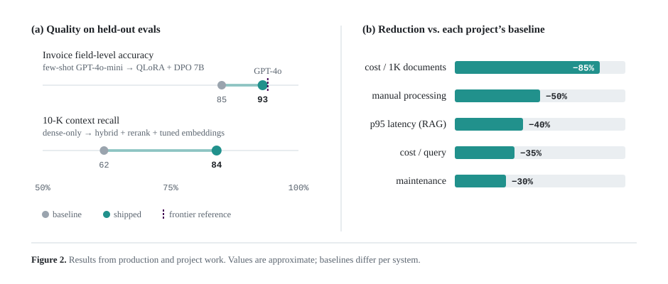
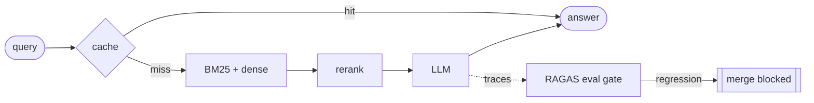

<picture>
  <source media="(prefers-color-scheme: dark)" srcset="assets/attention-dark.svg">
  
</picture>

[LinkedIn](https://linkedin.com/in/govind--sharma) &nbsp;·&nbsp; [Email](mailto:govindsarswat256@gmail.com) &nbsp;·&nbsp; [X](https://x.com/govind_msi) &nbsp;·&nbsp; [IEEE paper](https://ieeexplore.ieee.org/document/11234197)

### Abstract

I work on the unglamorous half of LLM engineering: getting systems that demo well to stay correct, fast and affordable in production. At Celebal Technologies I ship agentic document workflows for enterprise clients on Azure, AWS, GCP and Databricks. Outside work I build tools for agents: web search, memory, crawling. This page is laid out like a paper because that is how I think about the work. Claims need baselines, and results need evals.

### 1 &nbsp; Methods

| | |
|---|---|
| **Agents** | LangGraph supervisor graphs, MCP tools, async FastAPI |
| **Retrieval** | Hybrid BM25 + dense, cross-encoder rerank, GraphRAG on Neo4j |
| **Post-training** | QLoRA → DPO on open 7B models, served with vLLM + AWQ |
| **Evals** | RAGAS, LLM-as-judge, Langfuse, CI gates on faithfulness |

```math
\mathcal{L}_{\mathrm{DPO}} = -\,\mathbb{E}\!\left[\log\sigma\!\left(\beta\log\frac{\pi_\theta(y_w\mid x)}{\pi_{\mathrm{ref}}(y_w\mid x)} - \beta\log\frac{\pi_\theta(y_l\mid x)}{\pi_{\mathrm{ref}}(y_l\mid x)}\right)\right]
```

### 2 &nbsp; Results

<picture>
  <source media="(prefers-color-scheme: dark)" srcset="assets/results-dark.svg">
  
</picture>

The GraphRAG pipeline indexes 15K+ documents and improves retrieval accuracy by about 35% over a vector-only baseline. The Text-to-SQL agent uses human-in-the-loop validation and lets 50+ non-technical users run their own analytics, so a request that used to take days now takes minutes.

### 3 &nbsp; System design



**Figure 3.** Eval-gated RAG over 2,000+ SEC 10-K filings.

### 4 &nbsp; Open source

| | |
|---|---|
| [**GEXA**](https://github.com/CodeGovindz/GEXA) | Web search API for AI agents |
| [**MindLayer**](https://github.com/CodeGovindz/MindLayer) | Switch LLMs without losing memory |
| [**Web-Crawler**](https://github.com/CodeGovindz/Web-Crawler) | Async crawler with JS rendering and stealth |
| [**Manan**](https://github.com/CodeGovindz/Manan) | Privacy-first mental health app |

### References

[1] "Enhancing Assistive Communication through IoT-Based Hand Gesture Recognition," *IEEE CCPIS*, 2025. [[IEEE Xplore]](https://ieeexplore.ieee.org/document/11234197)

<details>
<summary><b>Appendix A</b> &nbsp; Stack</summary>
<br>

```
agents      LangGraph, Semantic Kernel, MCP, FastAPI (async), Pydantic
retrieval   FAISS, Neo4j, BM25, cross-encoders, Azure AI Search, Databricks Vector Search
training    PyTorch, TRL, Unsloth, PEFT (LoRA / QLoRA), DPO, LayoutLMv3
serving     vLLM, AWQ, Docker, Kubernetes, Terraform
ops         MLflow, Langfuse, RAGAS, GitHub Actions, Azure DevOps
cloud       Azure OpenAI, AWS (SageMaker, Bedrock, ECS), GCP Vertex AI, Databricks
```

</details>
